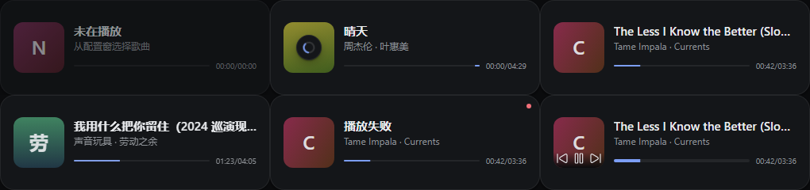
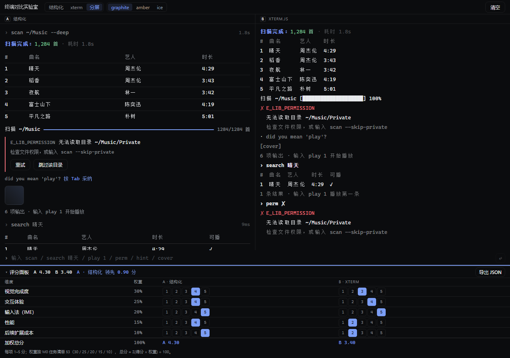
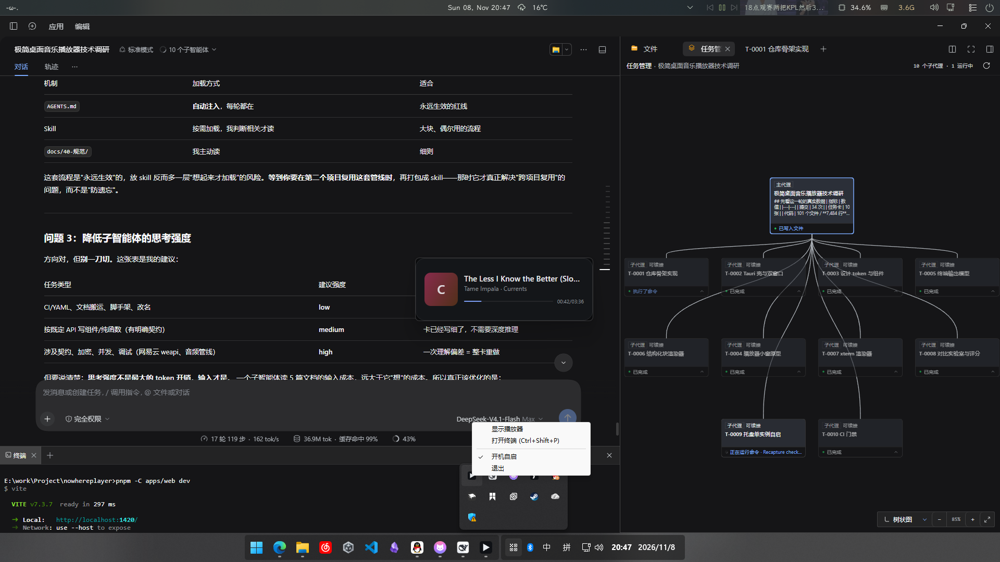

# Nowhere Player

一个常驻桌面的极简播放器小窗，配一个纯 CLI 风格的配置窗。跨 Windows / macOS / Linux。

> 当前进度：**M0 已完成**（骨架、双窗口、设计系统、终端双方案、托盘常驻、CI）。音频引擎在 M1。

---

## 截图

| 播放器小窗（6 状态） | 终端双方案对比 |
|---|---|
|  |  |

| 托盘菜单 |
|---|
|  |

---

## 快速开始

需要 Node ≥ 20、pnpm 11、Rust 1.98、Windows 需 WebView2（Win11 自带）。

```bash
pnpm install
pnpm -C apps/desktop tauri dev
```

启动后：播放器小窗出现 → `Ctrl+Shift+P` 打开终端窗 → 关掉终端窗进程仍在，托盘图标常驻。

首次编译约 2–5 分钟。**构建顺序很重要**：必须先 `pnpm install` 再 `cargo build`，因为 Tauri 的 `generate_context!` 在编译期读取 `apps/web/dist`。

### 只跑前端（不启动 Tauri）

```bash
pnpm -C apps/web dev
```

- 播放器：`http://localhost:1420/?window=player`
- 终端对比实验室：`http://localhost:1420/?window=terminal&variant=both`
- 设计系统 demo：`http://localhost:1420/design.html`

---

## 快捷键

| 快捷键 | 作用 | 生效范围 |
|---|---|---|
| `Ctrl/Cmd + Shift + P` | 打开/隐藏终端窗 | 全局 |
| `Ctrl + W` | 播放器窗隐藏到托盘 | 播放器聚焦时 |
| `Ctrl + Q` | 退出应用 | 播放器聚焦时 |

托盘菜单：显示播放器 / 打开终端 / 开机自启（勾选）/ 退出。

---

## 目录结构

```
crates/           纯 Rust 模块（np-core 已有终端输出模型，其余待填）
apps/desktop/     Tauri 壳（窗口、托盘、单实例、快捷键）
apps/web/         React 前端（player / terminal 两个视图 + design 与 lab 页）
docs/             全部文档，入口 docs/README.md
scripts/          门禁脚本 check.ps1 / check.sh
```

---

## 开发

| 目的 | 命令 |
|---|---|
| 全量门禁 | `pwsh scripts/check.ps1` |
| 前端测试 | `pnpm -C apps/web test` |
| Rust 测试 | `cargo test --workspace` |

贡献或接手前先读 [`AGENTS.md`](AGENTS.md)（项目地图、验证命令、红线）与 [`docs/30-计划/当前状态.md`](docs/30-计划/当前状态.md)（进度与欠账）。

---

## 文档

- [文档索引](docs/README.md)
- [开发方案](docs/30-计划/开发方案-v0.1.md)
- [技术调研](docs/20-架构/技术调研-2026-11.md)

---

## 许可

MIT OR Apache-2.0（代码）。在线音源仅用于个人学习与试听，详见文档免责说明。
