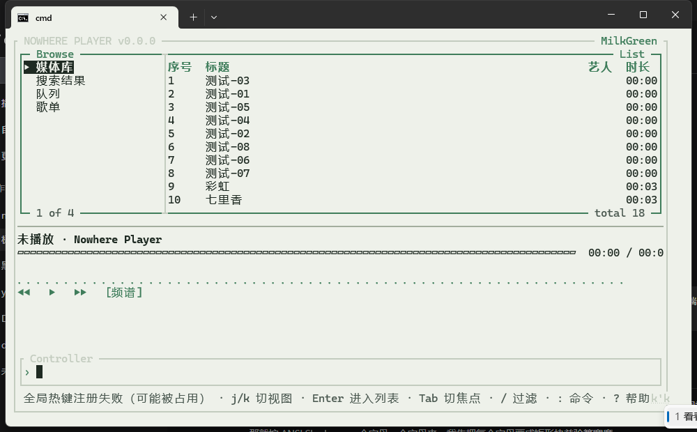

# Nowhere Player

Windows 优先的终端音乐播放器：本地媒体库 + B 站 / 网易云在线音源 + B 站直播音频 / 弹幕 + 独立视频窗口。

纯 Rust，Ratatui 界面，单二进制 `np-tui`。没有 Tauri、没有 WebView、没有 Electron。

> 早期版本 `0.1.0`。Windows 是主平台；macOS / Linux 可以编译和播放，但托盘、自启、启动器等系统集成尚未等价。



## 特性

- 本地媒体库：添加扫描根、增量扫描、按标题 / 艺人 / 专辑检索。
- 播放：播放 / 暂停 / 切歌 / seek / 音量 / 循环 / 随机。
- 在线音源：B 站搜索、取流、下载缓存；网易云匿名搜索 / 取流。
- 队列与歌单：本地 + 在线条目，增删改查、按歌单播放。
- 直播：Browse「直播」页输入房间号，或 `:live <房间号>` 听 B 站直播；Live 页、弹幕浮层、弹幕发送、`v` 打开独立视频窗口。
- 主题：内置 MilkGreen + 用户 JSON 主题，运行期切换。
- 终端界面：72×24 三区布局、内容区上限 144×48、专注模式（`Ctrl+F`）、Browse 树（歌单 / 媒体库 / 搜索 / 直播 / 队列 / 设置）、Controller 补全、启动页淡入/呼吸、三种 UI 音效主题（开关 / 打字机 / 轻触，可关）、7 种动态视觉样式（频谱 / 柱状 / 波形 / 镜像 / 矢量 / 环形 / 星野，频谱带 110Hz 高通、平均能量、A-weighting + 3dB/oct 倾斜、0.85 headroom、噪声门和重力回落，默认 2 格柱 + 1 格间隔；波形为均匀 Braille）、可折叠 Settings 分类树。
- Windows 集成：托盘、全局热键、单实例、开机自启（写 HKCU Run，无需管理员；每次启动按当前 exe 路径自愈）。

## 快速开始

需要 Rust `1.98.0`（见 `rust-toolchain.toml`）。Windows 建议使用 Windows Terminal；Linux 需要 ALSA 开发库。

```powershell
cargo build --release -p np-tui
target\release\np-tui.exe
```

也可以直接从桌面快捷方式启动，避免 console 自举闪窗：

```powershell
pwsh -File scripts/install-nowhere-shortcut.ps1
```

无头自检：

```powershell
$env:NP_TUI_SELFTEST = "search 晴天;play 2"
target\release\np-tui.exe
```

数据目录默认在 `%APPDATA%\com.nowhere.player`；可用 `NP_TUI_DATA_DIR=<dir>` 隔离。若该目录不可写，启动时会依次退到 `%LOCALAPPDATA%`、`AppData\LocalLow` 或 `%TEMP%` 下的 `com.nowhere.player`，并在状态栏/日志提示，不需要管理员权限。从低完整性目录启动的便携包会使用 LocalLow。

## 常用键位

| 键 | 动作 |
|---|---|
| `Space` | 播放 / 暂停 |
| `,` / `.` | 上一首 / 下一首 |
| `[` / `]` | 后退 / 前进 5 秒 |
| `+` / `-` | 音量 ±5% |
| `←` / `→` | Browse ↔ List 焦点 |
| `Ctrl+F` | 专注模式：隐藏 Browse/List，Player 占满；再按退出 |
| `f` | 切换 Player 视觉样式（状态栏显示当前样式） |
| `↑` / `↓`、`j` / `k` | 移动 |
| `Enter` | 进入 / 播放 / 确认 |
| `s` | 全局搜索 |
| `/` | 命令浮层 |
| `a` / `r` | 加入歌单 / 移除 |
| `Esc` | 返回 / 取消 |
| `q` | 退出（再按 `Enter` 确认） |

直播：Browse 里选「直播」→ `Enter`/`→` 进入 List → 再 `Enter` 聚焦输入框 → 输入房间号 → `Enter` 开播（`↑↓` 选历史、`Delete` 删除、`Esc` 退出输入）；也可以直接 `:live <房间号>`。开播后 `d` 弹幕浮层，`c` 发弹幕，`v` 视频窗口，`Esc` 停止。历史存配置目录下的 `live_history.json`（Windows 为 `%APPDATA%\com.nowhere.player\live_history.json`），最多 20 条，主播名到达后自动回填。

完整键位和命令见 [TUI 交互模型](docs/10-设计/TUI交互模型.md) 与 [命令表](docs/30-计划/命令表.md)。

## 项目结构

```text
crates/
  np-core/      领域模型、命令、设置、主题 schema
  np-audio/     解码、重采样、输出、播放状态机
  np-library/   扫描、标签、SQLite、歌单
  np-sources/   B 站、网易云
  np-live/      B 站直播 API、FLV、弹幕协议
  np-app/       与宿主无关的命令执行器
  np-tui/       Ratatui UI、事件循环、托盘、热键、启动器
  np-video/     自建 Win32 视频窗口（mpv）
docs/           设计、架构、计划、任务卡
packaging/      Inno Setup / winget / Scoop 分发文件
scripts/        构建、门禁、验收脚本
```

## 开发

```powershell
cargo fmt --all -- --check
cargo clippy --workspace --all-targets -- -D warnings
cargo test --workspace
pwsh -NoProfile -File scripts/check.ps1
```

接手前先读 [AGENTS.md](AGENTS.md)；当前进度见 [当前状态](docs/30-计划/当前状态.md)。

## 许可

MIT。见 [LICENSE](LICENSE)。

在线音源仅用于个人学习与试听，请遵守各平台的服务条款。
